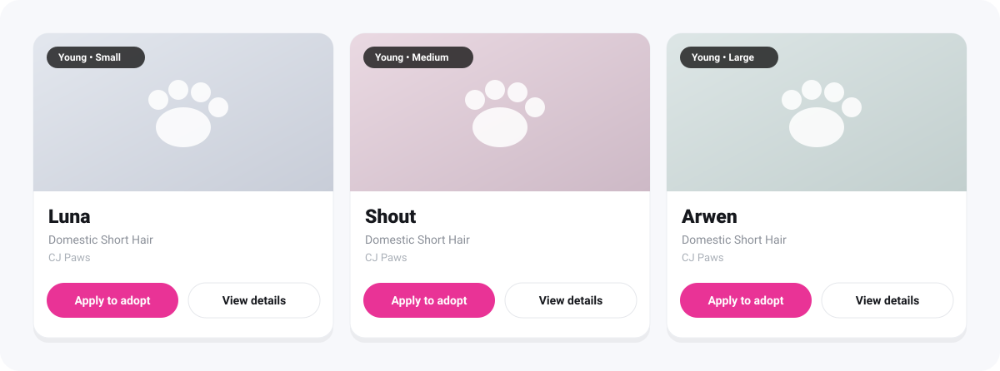

<p align="center">
  
</p>

<p align="center">
  
  
  
  
  
  
</p>

<p align="center">
  <b>A WordPress plugin that shows your shelter's adoptable Petfinder pets in a beautiful, filterable grid.</b><br>
  No API key. No cron. Listings load on demand and are cached on your site and in the browser.
</p>

<p align="center">
  
</p>

---

## ✨ Features

| | |
| --- | --- |
| 🐾 **Live Petfinder listings** | Real adoptable pets with photos, names, breed, size, age, and location. |
| 🔎 **Instant filtering** | Filter by breed, size, and age in the browser, with removable chips. |
| 📖 **Pet stories (flip card)** | Flip a card to read the pet's description — an accessible disclosure with keyboard focus handling and Escape to close; auto-detected with safe fallback. |
| 🎚️ **Card display toggles** | Show/hide location, story, breed, and the age/size badge per site. |
| 💌 **Apply to adopt** | Optional button linking each pet to your application form, prefilled with its name & ID. |
| 📄 **Load more** | Shows a batch of pets at a time (`per_page`), with a "Load more pets" button for the rest. |
| 🎨 **Fully brandable** | Your accent color, your copy, 2–4 column layouts. |
| 📱 **Responsive** | Mobile-first grid that looks great from phone to desktop. |
| ⚡ **Fast & respectful** | A shared site cache (on by default) and a short browser cache cut repeat Petfinder calls; no plugin analytics. |
| 🔎 **SEO & AI ready** | Emits Schema.org JSON-LD (AnimalShelter + pet ItemList) for search engines and AI crawlers. |
| ♿ **Accessible** | Labelled controls, `aria-live` updates, managed keyboard focus, theme-proof contrast, RTL-aware controls, and reduced-motion support. |
| 🧰 **Admin tools** | A settings screen with a live style preview and built-in Help, plus a Petfinder Explorer for checking what data is available. |

## 🚀 Quick start

**Requirements:** WordPress 5.6+ and PHP 7.0+. Visitors need JavaScript
enabled to see listings (without it, the widget shows a short message and your
fallback links).

1. Copy this folder into `wp-content/plugins/purrfect-match/` — or build a ZIP
   (see [below](#-building-a-release-zip)) and upload it via **Plugins → Add New → Upload**.
2. Activate **Purrfect Match**.
3. Open **Settings → Purrfect Match** and set your Petfinder **organization ID**
   (required — e.g. `FL1629`), plus any branding/copy you like.
4. Drop the shortcode on any page or post:

```text
[purrfect_match]
```

## 🧩 Shortcode

With per-instance overrides:

```text
[purrfect_match organization="FL1629" type="cat" status="adoptable"
                limit="24" columns="3" brand="#e93396" hide_breed="false"
                title="Find your purr-fect match"]
```

For a compact four-card teaser ordered by Petfinder publication time:

```text
[purrfect_match limit="4" per_page="4" columns="4" sort="newest"]
```

| Attribute      | Default                      | Description                                              |
| -------------- | ---------------------------- | ------------------------------------------------------- |
| `organization` | *(none — required)*          | Petfinder display ID(s) or UUID(s), comma-separated.    |
| `type`         | `cat`                        | `cat`, `dog`, `rabbit`, `small-furry`, `bird`, `horse`, `barnyard`, `scales-fins-other`. |
| `status`       | `adoptable`                  | `adoptable`, `adopted`, `found`.                        |
| `sort`         | `default`                    | `default` preserves the established order; `newest` requests recently published pets first. |
| `limit`        | `0`                          | Max pets to load (`0` = all; up to 1000).               |
| `per_page`     | `24`                         | Pets revealed in each visible batch (`0` = show all).   |
| `columns`      | `3`                          | Desktop columns (2–4).                                  |
| `hide_breed`   | `false`                      | Hide the breed name and the breed filter.              |
| `adoption_form_url` | *(empty)*               | Link each pet to your application form ("Apply to adopt"). |
| `title`        | `Find your purr-fect match`  | Main heading.                                           |
| `eyebrow`      | `Adoptable Pets`             | Small label above the heading.                          |
| `subtitle`     | `Filter by breed, size, and age.` | Subheading.                                        |
| `brand`        | `#e93396`                    | Accent color (hex).                                     |
| `org_name`     | *(empty)*                    | Shown in the banner and as a location fallback.         |
| `org_website`  | *(empty)*                    | "Visit" link in the banner.                             |
| `show_credit`  | `true`                       | Show the small plugin credit in the footer.             |
| `adoptapet_url`, `petfinder_member_url` | *(empty)* | Fallback links shown if the live listings can't load. |
| `api_base`, `s3_url`, `petfinder_url` | Petfinder defaults | Advanced endpoint overrides (rarely needed). |

Attribute values for `type`, `status`, and `sort` are case-insensitive; an
unrecognized value falls back to the saved setting (or `default` for `sort`).

## 🛠️ Settings & admin tools

- **Settings → Purrfect Match** holds every option, grouped into Listing,
  Appearance & copy, Fallback links, Performance, and Advanced. A live style
  preview shows your brand color, heading, and button text color as you type.
  Card toggles cover **Show pet stories** (flip to read), **Show location**,
  **Show age & size badge**, and **Show plugin credit**; **SEO structured data**
  and the **Shared cache** live under Performance.
- **Help** (top-right tab on the settings screen) has a quick start, every
  shortcode attribute, a settings reference, and troubleshooting tips.
- **Tools → Petfinder Explorer** runs live GraphQL queries from your browser so
  you can see which fields Petfinder returns for your organization.
- Until an organization ID is saved, administrators see a setup notice in
  wp-admin.

Advanced settings (`api_base`, `s3_url`, `petfinder_url`) match the public
Petfinder widget and rarely need changing.

## 🗄️ Caching

| Layer | Where | Lifetime | Who writes it |
| ----- | ----- | -------- | ------------- |
| Visitor cache | The visitor's browser (`localStorage`) | 10 minutes | Each visitor's own browser |
| Shared cache (on by default) | Your site, via the REST route `purrfect-match/v1/pets` | **Cache lifetime** setting (default 120 minutes) | Logged-in users who can edit pages, when they view a page with the widget |

Visitors only ever read the shared cache. When it's empty or expired, their
browser loads listings from Petfinder directly. Results that aren't what was
asked for are shown but not cached: a `newest` request that fell back to the
default order, or a multi-organization list missing one whose lookup failed.

Because of caching, a newly published pet can take up to the cache lifetime to
appear; this also applies to `sort="newest"`. Lower **Cache lifetime**, or turn
the shared cache off, if freshness matters more than speed.

## ⚙️ How it works

Purrfect Match reproduces the data layer of Petfinder's own public *pet-scroller*
widget, entirely client-side:

1. A Petfinder **organization display ID** (e.g. `FL1629`) is resolved to a
   UUID via the `GetOrganization` GraphQL query; configured UUIDs are used directly.
2. The `SearchAnimal` query returns that organization's animals (name, photo,
   breed, size, age, location, optional description, and a detail-page link).
3. Results render into the grid, and the breed / size / age filters run
   instantly in the browser against the loaded set.

Requests go directly from the visitor's browser to Petfinder's public widget
endpoint — so there's **no API key to request and no server-side request from
your site** (an optional shared cache can serve a copy from your own site to cut
repeat calls).

## 🛠 Development

This is a standard WordPress plugin with **no build step** — edit the PHP, CSS,
and JS directly. See [CONTRIBUTING.md](CONTRIBUTING.md) for conventions and
the release checklist, and [tools/README.md](tools/README.md) for the
verification scripts:

```bash
node tools/verify-newest-sort.mjs          # front-end runtime contracts
php tools/verify-shortcode-sort.php        # shortcode handling
php tools/verify-shortcode-sort.php --docs # version numbers agree
php tools/verify-brand-contrast.php        # brand-color contrast + preview parity
```

`preview/` holds static design-review pages (`php -S 127.0.0.1:8765` from the
repo root, then open `/preview/public.php?state=ready`; states are `ready`,
`loading`, `empty`, `error`, and `story`).

### 📦 Building a release ZIP

```bash
bash bin/build.sh
```

Produces `dist/purrfect-match.zip` containing only the files that ship —
developer tools, examples, and docs are excluded automatically via
`.gitattributes`.

## 📁 Project structure

```text
purrfect-match.php                 Plugin bootstrap: constants, includes, init.
includes/class-settings.php        Options, defaults, and the Settings screen.
includes/class-purrfect-match.php  Assets, shortcode, and per-instance config.
includes/class-rest.php            Optional shared-cache REST endpoint.
templates/widget.php               Front-end markup (one instance per shortcode).
assets/css/purrfect-match.css      Namespaced widget styles (brand + columns via CSS vars).
assets/js/purrfect-match.js        Client-side GraphQL data layer + filter UI.
assets/css/admin.css               Settings screen styles.
assets/js/admin.js                 Settings screen live preview and copy buttons.
assets/css/explorer.css            Tools → Petfinder Explorer styles.
assets/js/explorer.js              Tools → Petfinder Explorer query runner.
uninstall.php                      Removes saved options and cache on delete.
readme.txt                         WordPress.org-style readme and changelog.

Development only (not in the release ZIP):
bin/build.sh                       Builds dist/purrfect-match.zip.
tools/                             Verification scripts and a GraphQL playground.
preview/                           Static design-review pages and screenshots.
examples/cjpaws.md                 A complete real-world configuration.
GATES.md                           Quality-gate audit record for 1.8.0.
```

## 🧹 Uninstall

Deleting the plugin from **Plugins** removes its saved settings and shared-cache
data on every site (multisite included). Visitor-cache entries in browsers
expire on their own.

## 🔒 Privacy & external services

Purrfect Match does not add form, account, or tracking data to Petfinder
requests and includes no plugin analytics. To show pets, listing data and
photos may load **in the visitor's browser** from Petfinder's public widget
data source (`psl.petfinder.com/graphql`) and photo CDN. Those services receive
ordinary connection metadata such as IP address, user agent, and request
headers. The shared cache stores only public listing data (names, breeds,
photos, stories, links) on your own site. See the [readme](readme.txt)
"External services" section for details.

> [!NOTE]
> Purrfect Match is **not affiliated with, endorsed by, or sponsored by
> Petfinder**. "Petfinder" is a trademark of its respective owner. Your use of
> Petfinder data is subject to Petfinder's terms and policies.

## 📄 License

[GPL-2.0-or-later](LICENSE). Plugin by [Andrew Mayes](https://www.andrewmayes.com/).
